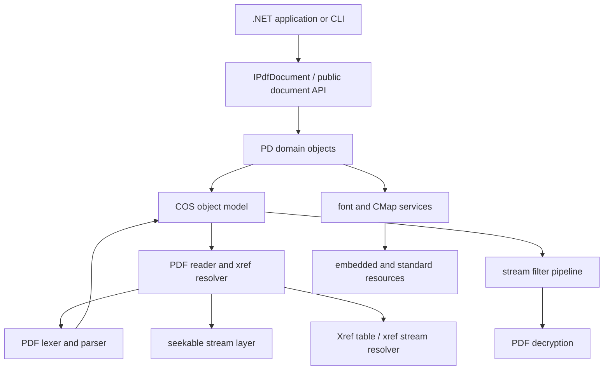

# veraPDF Parser Porting Plan for .NET

This document describes how to port the Java veraPDF parser library to C# and
.NET. It is written for entry-level developers. It describes the destination
architecture, an implementation order, testing, risks, and the open-source
libraries that may help.

## 1. Goal

Create a native .NET library that can:

- open PDF files and streams;
- read PDF syntax objects and indirect references;
- read traditional cross-reference tables and cross-reference streams;
- resolve objects across incremental revisions;
- expose PDF document concepts such as catalog, pages, resources, streams,
  fonts, and annotations;
- read and create PDF objects with predictable ownership and disposal;
- decode common PDF stream filters;
- provide enough behavior parity to serve as the parser foundation for PDF/A
  and PDF/UA validation tools.

The first port should preserve document behavior, not Java implementation
details. It should not require a Java runtime or call Java code through JNI.

## 2. Recommended approach

Use a native C# port and build one small layer at a time.

Keep the port completely separate from the existing Java code:

- do not place C# projects inside `src/main/java`;
- do not replace or move Java source files;
- use a top-level `dotnet/` directory for the C# solution;
- keep C# source, tests, fixtures, sample applications, build settings, and
  port-specific documentation below `dotnet/`;
- keep this plan in the repository's existing `docs/` folder for discovery.

The existing Java Maven project remains the behavior reference and is not
modified merely to support the C# port.

Do not start by translating all Java classes at once. Instead:

1. Port the binary and PDF syntax primitives.
2. Port cross-reference and object resolution.
3. Port stream decoding.
4. Port high-level document wrappers.
5. Compare output with the Java parser and independent PDF tools.
6. Expand font, structure, form, and image support.

A native port is preferable to a Java wrapper because:

- it works without a Java runtime;
- it uses .NET `Stream`, disposal, logging, and NuGet conventions;
- it can be trim- and AOT-friendly;
- failures and resource ownership are easier to diagnose;
- it can have a maintainable C# API.

## 3. Target platform

Use one primary target first:

- target **.NET 10**, the current LTS platform at the time of this plan;
- use SDK-style projects and package references;
- initially support Windows, Linux, and macOS through cross-platform APIs;
- expose the lowest useful public API in one core library;
- add CLI and test projects without putting them in the core library.

Before implementation, pin exact SDK and package versions in `global.json`,
`NuGet.config`, and the solution. Do not rely on floating package versions.

## 4. Proposed solution layout

```text
dotnet/
├── VeraPdf.Parser.sln
├── global.json
├── NuGet.config
├── Directory.Build.props
├── Directory.Packages.props
├── src/
│   ├── VeraPdf.Parser.Core/
│   │   ├── Cos/
│   │   ├── Io/
│   │   ├── Fonts/
│   │   ├── Pdf/
│   │   ├── Resources/
│   │   └── Streams/
│   └── VeraPdf.Parser.Cli/
├── tests/
│   ├── VeraPdf.Parser.Tests/
│   ├── VeraPdf.Parser.Fixtures/
│   └── VeraPdf.Parser.Compatibility/
├── samples/
├── docs/
└── README.md
```

The Java source remains at:

```text
src/main/java/
src/main/resources/
src/test/java/
src/test/resources/
pom.xml
```

The core library should not depend on the CLI or test projects. The C# solution
must be buildable from `dotnet/` without changing any Java source.

The suggested projects are:

| Project | Responsibility |
|---|---|
| `dotnet/src/VeraPdf.Parser.Core` | Native parser, PDF object model, document wrappers, filters, fonts, and public API |
| `dotnet/src/VeraPdf.Parser.Cli` | Simple commands for manually opening and inspecting PDFs |
| `dotnet/tests/VeraPdf.Parser.Tests` | Unit and integration tests |
| `dotnet/tests/VeraPdf.Parser.Fixtures` | Generated or small test PDFs and known font fixtures |
| `dotnet/tests/VeraPdf.Parser.Compatibility` | Differential tests against approved Java and third-party results |
| `dotnet/docs` | C#-port-only design notes, API notes, and known gaps |
| `dotnet/samples` | C# examples that depend only on the port |

## 5. Architecture



### 5.1 Public document API

The public entry point should be a C#-friendly document service similar to:

```csharp
using VeraPdf.Parser;

using var document = PdfDocument.Open(filePath);

var catalog = document.Catalog;
foreach (var page in catalog.Pages)
{
    // Inspect the page and its resources.
}
```

For streams:

```csharp
using var document = PdfDocument.Open(
    inputStream,
    leaveOpen: false);
```

Use `IDisposable` and `IAsyncDisposable` consistently. The first synchronous
version may read only `SeekableStream` implementations. Do not add `Task` APIs
until asynchronous reads are implemented all the way through the parser.

### 5.2 Lexer and parser

The lexer reads bytes and produces PDF tokens:

- integers;
- real numbers;
- names;
- strings;
- arrays;
- dictionaries;
- keywords;
- comments.

The parser combines tokens into `CosValue` objects. It must remain byte-safe:
PDF streams and file names are not ordinary UTF-8 text.

The Java names `BaseParser`, `COSParser`, `PDFStreamParser`, and
`XrefStreamParser` should become C# services such as:

- `PdfLexer`;
- `CosParser`;
- `PdfStreamParser`;
- `ObjectStreamParser`;
- `PdfParser`;
- `XRefParser`.

### 5.3 COS object model

Create an abstract `CosValue` hierarchy instead of storing every Java-like
object in `object` or `dynamic`.

Suggested types:

```text
CosValue
├── CosBoolean
├── CosInteger
├── CosReal
├── CosName
├── CosString
├── CosNull
├── CosArray
├── CosDictionary
├── CosStream
└── CosIndirectReference
```

Use separate types for:

- an indirect reference, such as `n g R`;
- an resolved indirect object;
- a direct PDF object;
- an object key.

Use immutable value types or records for `CosIndirectReference` and
`CosKey`. Implement value equality so dictionary and cache lookups work.

A dictionary should distinguish:

- a missing key;
- a present key containing `CosNull`;
- an invalid value type.

Avoid Java's practice of using a sentinel `COSObject` for free entries. In C#,
prefer a result type or enum for resolved, missing, and free objects.

### 5.4 Object reader and cross-reference resolver

`COSDocument` should own:

- the source stream and its lifetime;
- the header;
- the trailer;
- cross-reference state;
- indirect-object caches;
- resource and font caches;
- decryption state.

The reader should accept a seekable `Stream` and know whether it owns that
stream.

The cross-reference resolver has to support both:

- traditional `xref` tables;
- cross-reference streams;
- hybrid references;
- incremental updates;
- linearized PDFs.

Never use `int` for PDF file offsets. Use `long` for byte positions.

A cross-reference entry should be represented by a discriminated union or
sealed record hierarchy rather than a signed `long` sentinel:

- free entry;
- direct in-file entry;
- compressed entry in an object stream.

### 5.5 Stream pipeline

COS streams require two different views:

- **raw data**: bytes stored in the PDF;
- **decoded data**: bytes after filter and predictor processing.

Implement bounded decoding:

- absolute output limit;
- expansion ratio limit;
- object count limit;
- nesting limit;
- cancellation support;
- clear errors for truncated or malformed data.

Port filters with format-specific tests:

1. Flate
2. ASCIIHex
3. ASCII85
4. RunLength
5. LZW
6. Predictor
7. DCT/JPX and other external-encoded formats only if required
8. Crypt filters and encryption

Do not let decoded size exceed configured limits.

### 5.6 High-level PD domain model

The PD layer should wrap COS objects and expose PDF concepts:

```text
PdfDocument
├── PdfCatalog
├── PdfPageTree
├── PdfPage
├── PdfResources
├── PdfFont
├── PdfAnnotation
├── PdfForm
├── PdfMetadata
└── PdfStructure
```

Optional PDF values should become nullable C# values or a result type.
Collections should be read-only unless the operation intentionally creates or
modifies a PDF.

The high-level layer should depend on the COS model and reader, not vice versa.
It should not read raw file offsets itself.

### 5.7 Fonts and resources

Keep this as a later phase but design the extension point early:

- font format interfaces;
- CMap lookup;
- encoding maps;
- embedded font data;
- standard font metrics;
- document-scoped font cache;
- identifier that includes the indirect object and interpretation inputs.

The cache key must include relevant CMap, encoding, symbolic, CFF, and subset
state. A missing indirect key must not add a null cache key.

### 5.8 Writing and modification

Writing is a separate interface:

```csharp
public interface ICosWriter
{
    void Write(CosValue value, Stream output);
}
```

Preserve two modes:

- full rewrite;
- incremental update.

Do not combine writing and validation in the parser. Keep writer offsets and
cross-reference generation deterministic and test them byte-by-byte.

## 6. Java-to-.NET mapping

| Java pattern | .NET pattern |
|---|---|
| `java.io.InputStream` | `System.IO.Stream` |
| `java.io.OutputStream` | `System.IO.Stream` |
| `File` / `FileInputStream` | `FileStream` or `RandomAccessStream` |
| `HashMap<K, V>` | `Dictionary<K, V>` |
| `List<T>` | `IReadOnlyList<T>` or `IList<T>` |
| `java.util.logging.Logger` | `Microsoft.Extensions.Logging.ILogger<T>` |
| `IOException` | typed exceptions derived from `IOException` |
| `null` reference | C# `null` only after enabling nullable reference types |
| Java visitor | C# pattern matching or a visitor interface |
| `close()` | `Dispose()` or `DisposeAsync()` |
| checked exceptions | normal .NET exceptions, but retain typed parser exceptions |
| interned `ASAtom` values | frozen enums, constants, interned strings, or lookup dictionaries |
| platform float parsing | `double`/`decimal` with invariant culture |
| Java's signed `long` offsets | C# `long` with explicit range checks |

Do not preserve Java package names or implementation classes as public C#
APIs.

## 7. Open-source libraries to evaluate

### 7.1 PdfPig

[UglyToad.PdfPig](https://github.com/UglyToad/PdfPig) is a .NET library that
reads and creates PDFs. It is Apache-2.0 licensed and is available through
NuGet. It provides PDF objects, text and letter extraction, annotations,
embedded documents, metadata, forms, and document creation.

Use it for:

- independent compatibility tests;
- text and page extraction verification;
- study of mature .NET PDF parsing patterns;
- exposing text-extraction features if they match product requirements.

Do not make PdfPig the default implementation for every parser feature. This
plan ports veraPDF behavior, and the two libraries have different APIs and
validation goals.

The package and license must be verified and pinned before production use.

### 7.2 PDFium and PDFium wrappers

PDFium is useful as an independent rendering engine. .NET wrappers such as
PDFiumSharp may help render pages or compare parser behavior.

Do not use rendering output as the parser's ground-truth object model. PDFium
may also introduce native binaries and platform-specific deployment.

Verify the wrapper and PDFium licenses for the final distribution. PDFium
has a BSD-style license, while third-party wrapper licenses can differ.

### 7.3 PDFsharp 6.2.4 and earlier

PDFsharp is another .NET PDF library. The MIT-licensed 6.2.4 and earlier
versions can be useful for creation, rendering, and compatible test documents.
Later PDFsharp 6.5 and 7 releases use AGPL or commercial licensing.

Pin an old approved version only if the project can legally use it and a
security review has approved the dependency. Do not accidentally upgrade to
an incompatible license.

### 7.4 veraPDF .NET ports

A third-party `.NET 10` veraPDF port has appeared, but it should not be
adopted without an engineering and legal review. Confirm:

- repository identity and maintainer;
- GPL/MPL/other license compatibility;
- source provenance;
- implementation completeness;
- security history;
- test parity;
- maintenance activity.

Do not copy code unless every copied file is compatible with this project's
license and has recorded attribution.

## 8. Licensing plan

This repository is dual-licensed under GPLv3+ and MPLv2+. The port must:

- retain required copyright and license notices;
- decide whether the product will be distributed under GPL or MPL;
- add separate attribution for copied or adapted files;
- record third-party licenses in `THIRD-PARTY-NOTICES.md`;
- stop work and request legal review if a dependency's license is unclear.

Apache-2.0 libraries such as PdfPig may be used as independent references, but
the final license choice still applies to the port.

## 9. Implementation phases

### Phase 1: repository and test foundation

**Status:** complete. The implementation record is in
[Phase 1 foundation](../dotnet/docs/phase-1-foundation.md).

Deliverables:

- a top-level `dotnet/` directory for every C# project and C# build setting;
- a new `dotnet/VeraPdf.Parser.slnx`;
- core, CLI, unit-test, and compatibility-test projects;
- `dotnet/global.json`;
- `dotnet/NuGet.config`;
- central package and build settings below `dotnet/`;
- a C# port `dotnet/README.md` explaining clean setup and build commands;
- no C# source or project files outside `dotnet/`;
- package lock or restore policy stored below `dotnet/`;
- baseline Java test inventory;
- test corpus layout;
- CI for Windows, Linux, and macOS.

Exit criteria:

- the solution builds in CI;
- test project discovery works;
- there are no external runtime dependencies in the core library except
  approved NuGet packages.

### Phase 2: streams and lexer

**Status:** complete. The implementation record is in
[Phase 2 streams and lexer](../dotnet/docs/phase-2-streams-and-lexer.md).

Deliverables:

- seekable stream wrapper;
- byte-oriented lexer;
- numbers, names, strings, arrays, dictionaries, and keywords;
- comments and whitespace handling;
- stream length and `/Length` resolution.

Exit criteria:

- all existing Java stream and parser unit tests have C# equivalents;
- a non-seekable stream is either rejected clearly or spooled safely;
- binary bytes survive parsing unchanged.

### Phase 3: COS model and xrefs

**Status:** complete. The implementation record is in
[Phase 3 COS and xrefs](../dotnet/docs/phase-3-cos-and-xrefs.md).

Deliverables:

- complete COS value hierarchy;
- indirect reference and key types;
- direct and indirect object resolution;
- traditional xref parser;
- xref stream parser;
- trailer and incremental revision merge;
- object and object-stream caches.

Exit criteria:

- the parser opens all approved fixture PDFs;
- differential tests agree with the Java parser on object types and values;
- malformed xrefs fail with bounded, typed errors;
- cross-reference loops are detected.

### Phase 4: stream filters

**Status:** complete for native byte filters and predictor processing. The
implementation record is in
[Phase 4 stream filters](../dotnet/docs/phase-4-stream-filters.md).

Deliverables:

- filter registry;
- ASCIIHex, ASCII85, RunLength, Flate, and LZW;
- predictor processing;
- bounded decoded streams;
- encryption interface and standard security handler.

Exit criteria:

- existing Java filter tests pass;
- decompression bombs are rejected;
- malformed encoded streams return clear diagnostics;
- no filter silently allocates unbounded memory.

### Phase 5: PD document model

**Status:** complete for the document read model and full-rewrite output. The
implementation record is in
[Phase 5 PD document model](../dotnet/docs/phase-5-pd-document-model.md).

Deliverables:

- document, catalog, page tree, page, resources, and metadata;
- incremental save and full rewrite;
- annotations and forms;
- structure and optional-content wrappers.

Exit criteria:

- document open/close behavior is deterministic;
- pages and catalog entries resolve correctly;
- save/reopen produces valid PDFs;
- incremental save preserves the original bytes.

### Phase 6: fonts and advanced PDF features

**Status:** complete for CMap, standard AFM metrics, font metadata, and
basic TrueType cmap parsing. The implementation record is in
[Phase 6 fonts and resources](../dotnet/docs/phase-6-fonts-and-resources.md).

Deliverables:

- CMaps;
- TrueType, OpenType/CFF, Type1, and Type3 support;
- standard font metrics;
- image and color-space wrappers;
- font cache and resource limits.

Exit criteria:

- existing font and CMap tests pass;
- embedded and standard fonts behave as expected;
- missing font data produces typed diagnostics instead of crashes.

### Phase 7: validation readiness

**Status:** complete for preview packaging, CI, API documentation, known-gap
reporting, and security boundaries. The implementation record is in
[Phase 7 validation and release](../dotnet/docs/phase-7-validation-and-release.md).

Deliverables:

- stable public API;
- API documentation;
- NuGet packaging;
- security review;
- performance and memory benchmarks;
- compatibility report.

Exit criteria:

- approved PDF/A and PDF/UA fixture sets pass;
- package restores and builds from a clean environment;
- public API review is complete;
- known gaps are documented.

## 10. Testing strategy

### Unit tests

Test each parser component in isolation:

- end-of-line handling;
- integer and real parsing;
- literal and hexadecimal strings;
- name decoding;
- balanced parentheses;
- array and dictionary parsing;
- stream EOL rules;
- filter edge cases.

Use xUnit or NUnit consistently. NUnit is already familiar in some veraPDF
workflows, but xUnit is an acceptable default if it is adopted for the whole
solution.

### Fixture tests

Keep a small, legally cleared fixture set for normal and malformed PDFs:

- PDF 1.4 through PDF 2.0;
- traditional and compressed cross-references;
- linearized PDFs;
- incremental updates;
- encrypted PDFs;
- damaged startxref entries;
- object cycles;
- embedded fonts and CMaps;
- filters and predictors.

Do not add copyrighted or sensitive documents to source control.

### Differential tests

For selected fixtures, compare:

- PDF version;
- trailer `/Root`;
- object count;
- pages and page resources;
- decoded stream hashes;
- font identifiers;
- parser warnings and fatal errors.

Use a frozen Java build and fixture manifest. A differential test passes only
when the .NET behavior matches the documented Java behavior or differs for an
approved, recorded reason.

### Independent tests

Use PdfPig or PDFium only for independent cross-checking. Do not use them to
fill in a missing Java behavior without an oracle; the .NET implementation
must still be backed by the Java source, PDF specification, and fixture tests.

## 11. Entry-level task sequence

Start with these small tasks:

1. Create `dotnet/VeraPdf.Parser.slnx` and one unit-test project below
   `dotnet/tests/`.
2. Implement `CosInteger`, `CosReal`, `CosName`, `CosString`, and `CosNull`.
3. Implement whitespace and comment scanning.
4. Implement arrays and dictionaries.
5. Implement a seekable stream wrapper.
6. Implement header and `startxref` scanning.
7. Implement traditional xref lookup.
8. Implement indirect object lookup.
9. Implement stream length and raw stream reads.
10. Implement Flate decoding.
11. Implement catalog and page lookup.
12. Add PdfPig differential tests.

Complete and test each task before moving to the next.

## 12. Key developer rules

- Keep all C# implementation and build artifacts under `dotnet/`.
- Never edit or relocate the Java source merely for C# port development.
- Read bytes as bytes; do not normalize PDF line endings.
- Use `long` for offsets and stream lengths.
- Validate array, dictionary, object-count, and stream bounds.
- Preserve the distinction between missing keys and PDF `null`.
- Do not return mutable internal dictionaries as public collections.
- Implement disposal at every stream-owning boundary.
- Keep parser and validation code independent.
- Add a test whenever a bug is found.
- Use nullable reference types and exception types to make failure modes clear.
- Prefer small services over a port of every Java static helper.
- Do not place document-wide mutable state in static classes.
- Record every compatibility exception in a test or known-gap document.

## 13. Risks and controls

| Risk | Control |
|---|---|
| Java behavior is intentionally different from PDF standards | Add a compatibility test and decide whether fidelity or standards compliance wins |
| Stream decompression exhausts memory | Hard size, ratio, nesting, and cancellation limits |
| Encrypted files expose hidden object errors | Typed password and decryption exceptions, no broad catch |
| Native PDFium binaries complicate deployment | Keep PDFium optional; package per RID separately |
| PdfPig license or API changes | Pin versions and run NuGet and license checks in CI |
| .NET type conversion loses PDF precision | Preserve integers separately from reals and use invariant culture |
| Resource files do not ship | Include fonts and CMaps as embedded resources |
| Third-party veraPDF port provenance is unknown | Require source, license, and contribution provenance review |
| Incremental save corrupts original bytes | Freeze original bytes and validate old offsets after reopening |
| Cross-reference loops cause hangs | Track visited revisions and entries |
| Public API grows too Java-like | Review names and nullability against .NET conventions |

## 14. Definition of done

The native port is ready for a validation feature only when:

- the core library builds and packages through NuGet;
- it opens all planned fixture PDFs;
- it passes unit and differential tests;
- stream decoding is bounded;
- disposal and resource ownership are verified;
- license notices are complete;
- public API review is complete;
- known unsupported features are documented;
- performance budgets are recorded;
- CI runs the test suite on supported operating systems.

## 15. Existing repository references

- [Repository reading guide](./repository-guide.md)
- [Porting dictionary](./porting-dictionary.md)
- [PDF document, catalog, and file structure](./pdf-document-catalog-and-file.md)
- [Java public document API](../src/main/java/org/verapdf/pd/PDDocument.java)
- [Java low-level document model](../src/main/java/org/verapdf/cos/COSDocument.java)
- [Java PDF parser](../src/main/java/org/verapdf/parser/PDFParser.java)
- [Java reader](../src/main/java/org/verapdf/io/Reader.java)
- [Java Maven project](../pom.xml)
